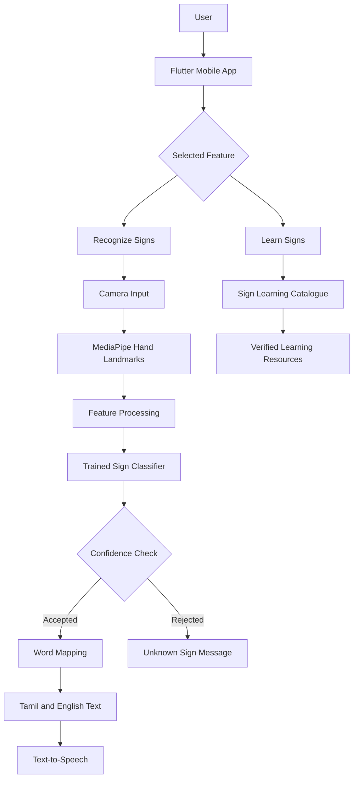

# Saigai Kural - System Architecture

## 1. Overview

Saigai Kural is designed as a mobile application with separate components for the user interface, hand tracking, sign classification, language mapping, and speech output.

The architecture separates the mobile application from model development so that each component can be tested and improved independently.

## 2. High-Level Architecture



## 3. Main Components

### 3.1 Mobile User Interface

Responsibilities:

- Display the login and home screens.
- Provide the Recognize and Learn tabs.
- Request camera permission.
- Display translations and recognition status.
- Provide accessible text and audio controls.

Technology: Flutter and Dart.

### 3.2 Camera Module

Responsibilities:

- Capture camera frames with user permission.
- Handle camera errors and permission denial.
- Send frames to the hand-tracking component.
- Avoid storing images unless storage is necessary and explicitly permitted.

### 3.3 Hand Landmark Extraction

MediaPipe detects hand landmarks from camera frames.

For one hand, the detector can produce 21 landmarks. Each landmark may contain x, y, and z coordinates, resulting in 63 coordinate values before any additional feature engineering.

Landmark coordinates must be normalized consistently during training and inference.

### 3.4 Feature Processing

Responsibilities:

- Validate landmark inputs.
- Normalize coordinates.
- Handle missing or low-quality detections.
- Apply the same feature-processing procedure during training and prediction.

### 3.5 Sign Classifier

The classifier maps processed features to supported sign labels.

A baseline model may use a scikit-learn classifier. A mobile implementation may use a compatible on-device model format.

The model must be trained on suitable, labelled data before real sign recognition can work.

### 3.6 Language Mapping

The mapping component associates a predicted label with approved translations.

Example:

```json
{
  "label": "HELLO",
  "english": "Hello",
  "tamil": "வணக்கம்"
}
```

This example illustrates the mapping format. The associated gesture must be verified before it is treated as a valid ISL example.

### 3.7 Speech Output

The app passes supported text to the device's text-to-speech engine.

The selected voice and available languages depend on the operating system and installed language support.

### 3.8 Learning Catalogue

The Learn screen provides supported vocabulary, Tamil and English meanings, and verified sign demonstrations or learning references.

## 4. Data Flow

1. The user opens the recognition screen.
2. The app receives camera frames.
3. The hand detector extracts landmarks.
4. The feature processor creates model inputs.
5. The classifier predicts a sign label.
6. A confidence threshold determines whether the prediction should be shown.
7. The language mapping returns Tamil and English text.
8. The user views the result and can request speech output.

If the hand is not detected or the prediction is uncertain, the app should display a clear message rather than inventing a translation.

## 5. Data Storage

The prototype may use:

- CSV files for sample and training data.
- Model files for trained classifier parameters.
- SQLite for local vocabulary and learning progress.
- Secure backend storage only if future features require an account service.

Do not store passwords in plain text. If authentication is added, use an established authentication provider or a properly secured backend.

## 6. Privacy and Security

- Request camera permission only when required.
- Explain why camera access is needed.
- Prefer on-device inference where practical.
- Do not upload recordings without informed consent.
- Do not commit credentials, tokens, or private recordings to GitHub.
- Provide a way to delete stored learning data if the application stores it.

## 7. Error Handling

The app should handle:

- Camera permission denied.
- Camera unavailable.
- No hand detected.
- Multiple or incomplete landmark detections.
- Unsupported sign label.
- Low-confidence prediction.
- Missing translation.
- Unsupported text-to-speech language.
- Missing or incompatible model file.

## 8. Testing Strategy

- Unit tests: validate mappings, features, and input formats.
- Model tests: evaluate predictions on held-out data.
- Integration tests: verify landmark extraction and classifier integration.
- UI tests: verify screen navigation and accessible feedback.
- Device tests: verify camera, performance, and speech output.

## 9. Future Improvements

- Support dynamic signs and temporal models.
- Evaluate two-hand gestures.
- Add a verified, broader ISL vocabulary.
- Improve offline inference.
- Expand regional-language support.
- Conduct usability and recognition studies with fluent ISL users.
